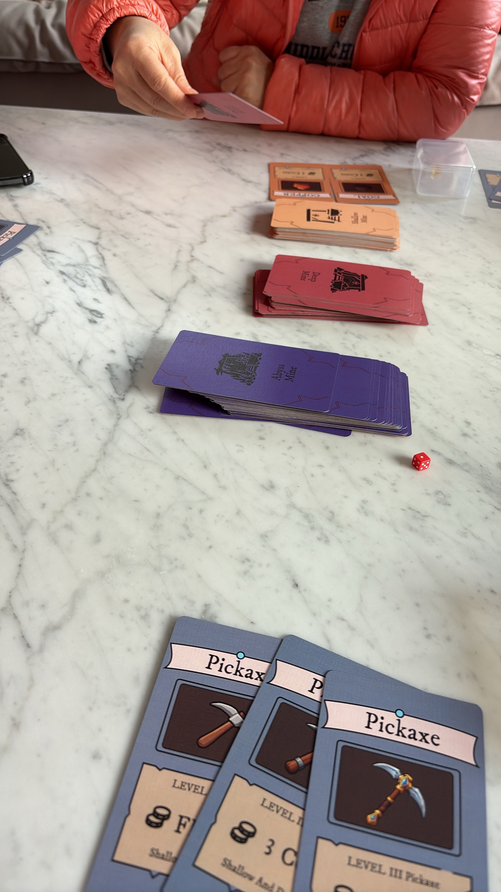

# Siyuan Sun | Game Design Portfolio

Gameplay, combat and level design at Nanyang Technological University.

[Resume (PDF)](Siyuan_Sun_Resume.pdf) · [Behance portfolio](https://www.behance.net/gallery/255371579/Siyuan-Suns-Game-Design-Portfolio)

## Object Keeper

**Single-player 3D bullet-hell boss battles**

You play a night-shift anomaly handler called into closed public spaces where everyday objects have come alive. Each compact arena holds one boss. You move, shoot and dodge as its bullet patterns change, looking for a gap to release your stored laser. We designed these short encounters for players who enjoy learning a pattern and finding their own opening.

**My special mechanic design · Blackout**

I designed Blackout around a question I wanted players to answer mid-fight: where is the boss firing from? When the lights go out, the boss disappears from view, but its projectiles stay visible. Players can follow a burst back to its source, slip through a gap and return fire before the lights come back on.

**My role on the team**

I led game design on our four-person team, shaped the premise and boss attack patterns, worked on combat UI/UX, and contributed as part of the Unity/C# programming team. I also designed the weapon heat system. A short pause between bursts lets the gun cool. Holding the trigger too long costs the player 2.5 seconds of normal fire.

[Watch gameplay (MP4)](https://raw.githubusercontent.com/48bin48/game-design-portfolio/main/object-keeper/gameplay.mp4) · [Project overview (PDF)](object-keeper/overview.pdf) · [Full presentation (PowerPoint)](object-keeper/object-keeper.pptx) · [Team repository](https://github.com/GDAT-AP6412/2026s1-project-2-team-04)

## Forgotten End

**A narrative-driven 2D Metroidvania**

In this single-player dark-fantasy adventure, a soul enters the Hall of Judgment and fights for fragments that grant new abilities. Combat and boss battles drive the journey, with platforming, exploration and light environmental puzzles between encounters. As the fragments come together, the trials reveal the life the player once lived and the people who still remember them.

**My role · Team lead and lead game designer**

- **Combat, balance and core systems.** I led the team and designed the main gameplay systems and mechanics, including combat balance, boss encounters and how players acquire abilities.
- **Story and animation.** I wrote the main story and designed the dancer bosses around a married couple who find each other again after death. I animated the ranged boss. In the fight, attacking her partner draws her down from the high wire. When the dancers reunite, their duet gives the player an opening to strike.
- **First-level design.** I designed the first level's map and prototyped its route from the garden to the underground guardian. The escape gives players a place to try Blink as soon as they earn it.
- **Music and UI.** I produced music for the game and guided the team on UI design and implementation.

[Boss fight demo](forgotten-end/videos/boss-fight-demo.mp4) · [Gameplay demo](forgotten-end/videos/basic-gameplay-demo.mp4) · [Project overview (PDF)](forgotten-end/overview.pdf) · [Full presentation (PowerPoint)](forgotten-end/forgotten-end.pptx) · [Level 1 map](forgotten-end/level-1.png)

## The Miners

**A push-your-luck tabletop card game · Solo project**

In each of six rounds, miners face the same decision after every safe draw: take their ore to the surface, or turn over one more card and risk a cave-in. Coins buy better pickaxes, but the player with the most coins at the end wins.

**What I made**

I created the entire game, from its rules, content and economy to its visual design and physical prototype. I designed the cards and their UI, including the color-coded mine decks and the pickaxe cards that show the upgrade cost and which layers a miner can enter. I wrote the rulebook, built the playable set and tested it at the table.

I tuned ore prices to make backpack space matter. Two level-I iron sell for six coins together. Merging them produces level-II iron worth eleven, so a miner has a reason to hold on to the first piece even when their six-slot pack is nearly full.

**In development.** I am still playtesting and refining the game to make each decision to stay or leave more fun. In a future version, I would like to give the game an educational dimension. One possibility I want to explore is whether the ore cards could help players recognize the minerals they collect.

[Project overview (PDF)](the-miners/overview.pdf) · [Full presentation (PowerPoint)](the-miners/the-miners.pptx) · [English rulebook](the-miners/rulebook.pdf)
