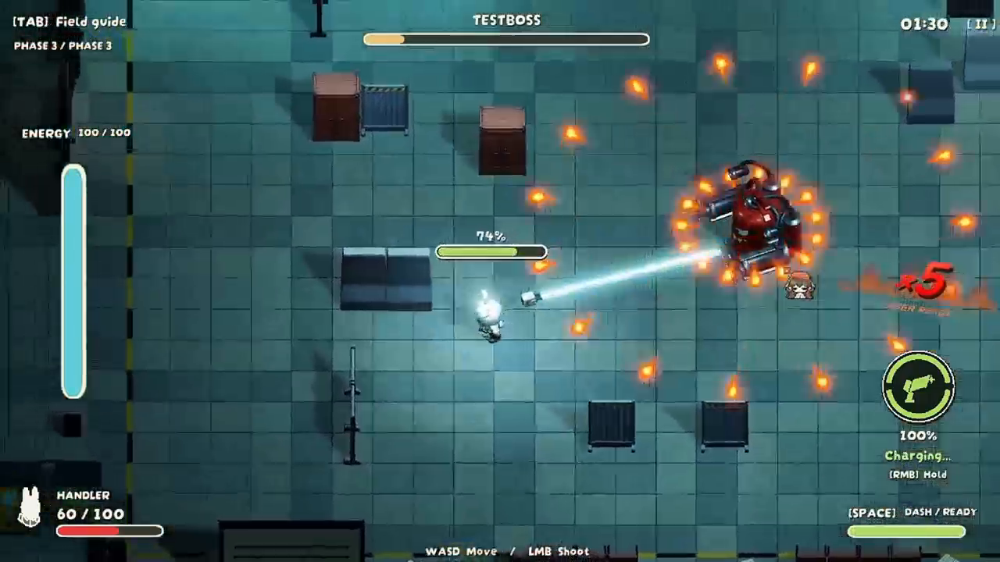
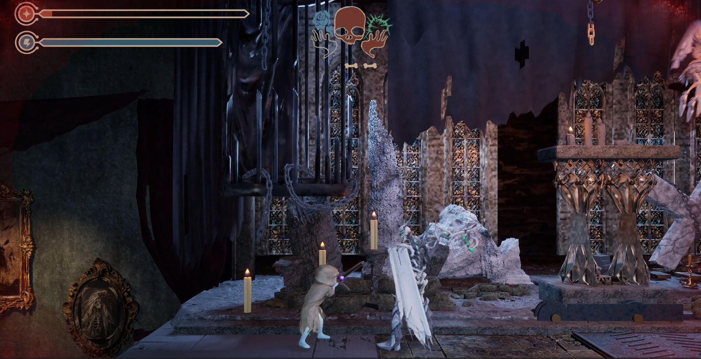

# Siyuan Sun | Game Design Portfolio

Gameplay, combat and level design at Nanyang Technological University.

[Resume (PDF)](Siyuan_Sun_Resume.pdf) · [Behance portfolio](https://www.behance.net/gallery/255371579/Siyuan-Suns-Game-Design-Portfolio)

## Object Keeper

After closing time, everyday machines become bosses. When the lights go out, the player can still track a boss by the direction of its fire.

**My role · Lead game designer, UI/UX designer and part of the C# programming team**

- I designed the blackout fight around one question. Could players locate a boss they could no longer see? I kept its projectiles visible and built gaps into the attack patterns so players could dodge, trace the shots back and return fire.
- I designed weapon heat to change the rhythm of the fight. Players can pause between bursts to cool the weapon or risk losing normal fire for 2.5 seconds. I also worked on the combat HUD and contributed to the team's Unity/C# implementation.

[Watch gameplay (MP4)](https://raw.githubusercontent.com/48bin48/game-design-portfolio/main/object-keeper/gameplay.mp4) · [Project overview (PDF)](object-keeper/overview.pdf) · [Full presentation (PowerPoint)](object-keeper/object-keeper.pptx) · [Team repository](https://github.com/GDAT-AP6412/2026s1-project-2-team-04)

## Forgotten End

A soul retraces a lifetime through a series of trials. Each soul the player collects belongs to someone who still remembers them.

**My role · Level, combat and narrative design**

- I designed and prototyped the first level, from a garden with a hidden lever to an underground route with traps and ranged enemies. I built the escape around Blink so players could use their new ability immediately after the guardian fight.
- I wrote the story of two dancers who find each other again after death and designed their boss encounter around that reunion. Hitting the grounded partner draws the other down from her high wire. Dodge her dive, and the moment they reach for each other becomes the player's opening to attack.

[Boss fight demo](forgotten-end/videos/boss-fight-demo.mp4) · [Gameplay demo](forgotten-end/videos/basic-gameplay-demo.mp4) · [Project overview (PDF)](forgotten-end/overview.pdf) · [Full presentation (PowerPoint)](forgotten-end/forgotten-end.pptx) · [Level 1 map](forgotten-end/level-1.png)

## The Miners

In this six-round tabletop game, miners decide after each safe draw whether to take their ore home or risk one more card.

**My role · Tabletop systems design, physical prototyping and playtesting**

- I built the mine decks and tested how far players would push a six-slot backpack. I wrote the cave-in rule so one die settles an expedition. On 1–3, return all newly mined ore. On 4–6, keep it all and stop mining for that expedition.
- I balanced ore prices and pickaxe upgrades around the fact that coins also determine the winner. Two level-I iron sell for six coins in total. Merge them and the level-II iron sells for eleven, but holding the pair until then takes up two slots.

[Project overview (PDF)](the-miners/overview.pdf) · [Full presentation (PowerPoint)](the-miners/the-miners.pptx) · [English rulebook](the-miners/rulebook.pdf)
